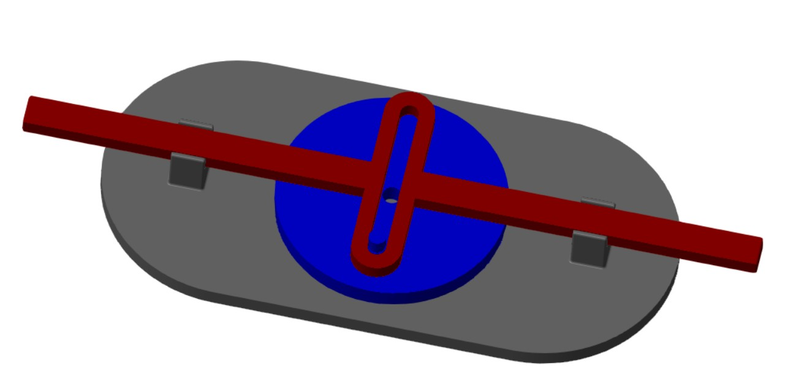
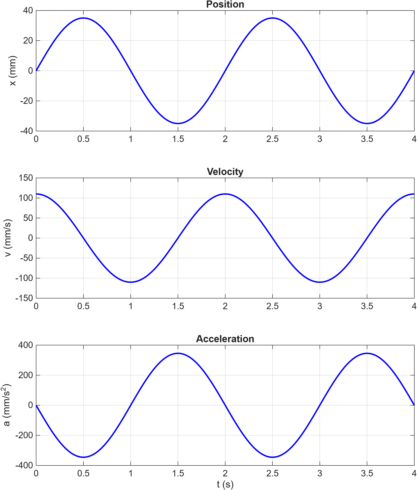
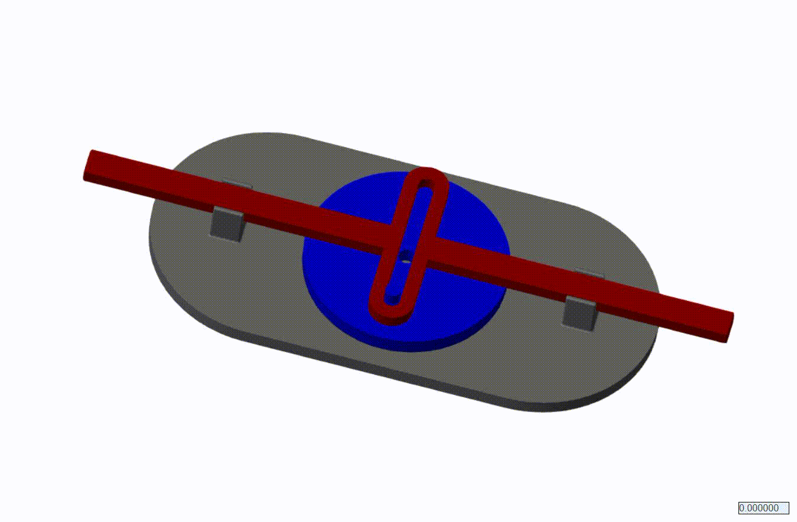
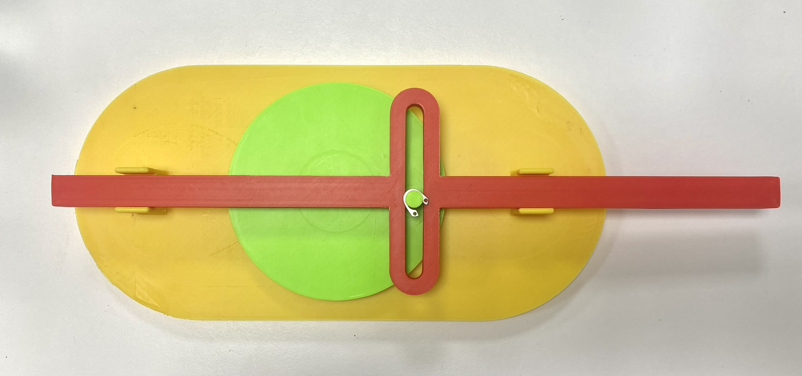
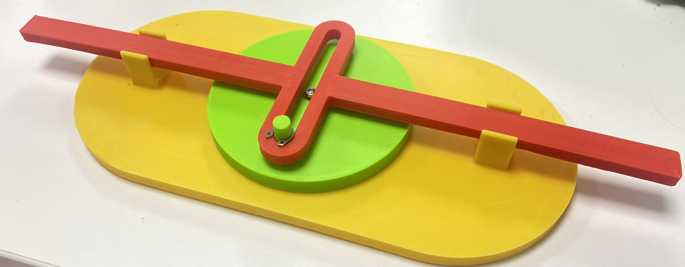

# Scotch Yoke Mechanism

## Project overview

- **Project name:** Scotch Yoke Mechanism
- **Purpose:** Convert crank rotation into simple harmonic linear motion; analyze it with Simscape Multibody and a built prototype
- **Course:** 2103-322 Design of Mechanism (2569), Term Project
- **Status:** In progress
- **Last updated:** 2026-11-16

| Member | Student ID | Responsibility |
| --- | --- | --- |
| Nathas Bunyarat | 6730135921 | Simscape Multibody |
| Yada Wajeenuruksakulchai | 6730122721 | Prototype |

## Structure

| Path | Purpose |
| --- | --- |
| `Multibody/` | Simscape Multibody model, exported data and plotting script |
| `Media/` | Images and the simulation video |
| `Prototype/` | Fusion 360 files of the parts used to build the prototype |

## Shared parameters

All parts of the project use the same values: crank radius r = 35 mm, constant crank speed
ω = 180 deg/s (period 2.00 s), and yoke stroke ±35 mm (70 mm total).

## Part I: Mechanism, kinematic model and DoF

### 1.1 Links and joints

| Link | Name | Part |
| --- | --- | --- |
| 1 | Ground (base) | `Base` |
| 2 | Crank (disk), r = 35 mm | `Disk` |
| 3 | Sliding block (pin in slot) | Pin on the disk |
| 4 | Yoke (slotted bar) | `Arm` |

| Joint | Type | Connects |
| --- | --- | --- |
| O2 | Revolute | Ground – Crank |
| A | Revolute | Crank – Block |
| B | Prismatic | Block – Yoke (slot) |
| O4 | Prismatic | Yoke – Ground (guides) |

### 1.2 Degrees of freedom

Using the Gruebler equation for planar mechanisms, with n = 4 links, j₁ = 4 lower pairs
(2 revolute, 2 prismatic) and j₂ = 0 higher pairs:

$$DOF = 3(n-1) - 2j_1 - j_2 = 3(4-1) - 2(4) - 0 = 1$$

Counting the pin-in-slot as one higher pair gives 3(3-1) - 2(2) - 1 = 1, the same result.

### 1.3 Workspace

| Quantity | Value |
| --- | --- |
| Pin path | Circle of radius 35 mm about the crank axis |
| Yoke travel | x = −35 to +35 mm |
| **Total stroke** | **70 mm (= 2r)** |

## Part II: Simscape Multibody

The model [`Scotch_Yoke_multibody.slx`](Multibody/Scotch_Yoke_multibody.slx) uses the Base, Disk and Arm
parts from CAD. The crank joint J1 is driven with Motion = Provided by Input, using a ramp
of 180 deg/s and its speed and acceleration supplied through a Simulink-PS Converter.
Sensing on the yoke joint (J2) gives position, velocity and acceleration.

With the crank angle θ measured from the vertical axis and constant ω, the reference equations are:

$$x = r\sin\theta, \qquad v = r\omega\cos\theta, \qquad a = -r\omega^{2}\sin\theta$$

### Results

| Quantity | Reference | Simscape |
| --- | --- | --- |
| Period (s) | 2.000 | 2.000 |
| Amplitude of x (mm) | 35 | 35.000 |
| Peak v (mm/s) | 110.0 | ≈ 110 |
| Peak a (mm/s²) | 345.4 | 345.4 |

The exported data is in [`kinematics.csv`](Multibody/kinematics.csv) and is plotted by
[`plot_script.m`](Multibody/plot_script.m).

### Simulation

Full video: [Mechanism.avi](Media/Mechanism.avi)

### How to run

1. Open MATLAB in the `Multibody/` folder and open `Scotch_Yoke_multibody.slx` (Simscape Multibody required).
2. Click Run (stop time 4 s).
3. Run `plot_script.m` to plot the results.

## Part III: Prototype

The wall-mounted model fits in a 210 × 297 mm area and uses the same r and stroke as the
simulation. CAD files are in [`Prototype/`](Prototype/).

| Part | Color | File |
| --- | --- | --- |
| Base (ground) | Yellow | `Base.f3d` |
| Crank disk | Green | `Disk.f3d` |
| Yoke (arm) | Red | `Arm.f3d` |

### Prototype photos

